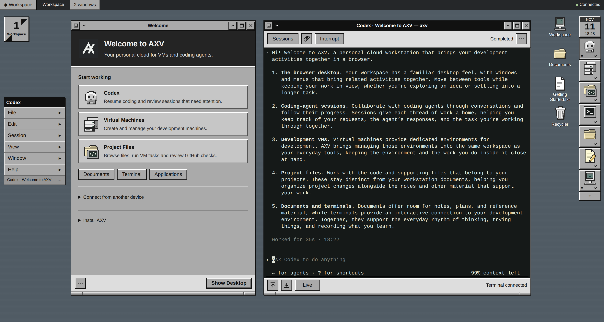

# AXV

[](https://github.com/cofy-x/axv/actions/workflows/ci.yml)

**Your personal cloud for VMs and coding agents.**

AXV brings coding-agent sessions, development VMs, files and terminals together in a Window Maker-inspired browser desktop. Run your workstation on your own Mac or Linux machine.

[Get started](#install-and-use) · [User guide](docs/usage.md) · [Documentation](docs/README.md) · [Contribute](CONTRIBUTING.md)



_A representative AXV desktop with Welcome and a real Codex conversation, captured in an isolated demo profile._

## Why AXV

- **Keep coding work together.** Start and reopen Codex conversations for host or registered VM projects, with activity and requests for input in the same desktop.
- **Give projects a VM workspace.** Manage development machines, retain project volumes, and run persistent build and test tasks with logs and cancellation.
- **Work across windows.** Organize files, edit Markdown and use host shells across four desktop workspaces.
- **Reach your own workstation.** Connect through optional Tailscale HTTPS or Cloudflare Access while work and storage stay on your deployment machine.

## Install and use

### Download for Linux amd64

Choose a Linux amd64 application archive from [Releases](https://github.com/cofy-x/axv/releases), then follow [archive installation](docs/startup.md#install-a-release-archive) to verify and install it. Check [platform support](#project-status); the selected release's notes describe that archive's features, prerequisites and upgrade limits.

The executable includes the Web UI and needs neither Go nor Node at runtime. Codex, tmux and VM providers are separate prerequisites; see [startup requirements](docs/startup.md#daily-commands).

### Build from source

Install **Go 1.27.3**, **Node 24.16.0**, and **pnpm 12.11.2**, then:

```bash
git clone https://github.com/cofy-x/axv.git
cd axv
make install
axv
```

`make install` builds and installs `axv` into Go's binary directory; follow its printed PATH guidance if needed. Run `axv` from any directory to start or reopen the workstation in your browser. Configuration and AXV-managed data default to `~/.axv`.

Background mode requires a macOS GUI login or a Linux systemd user manager (254 or newer). Otherwise, run `axv serve` and open the printed address. See [Startup](docs/startup.md) for updates, uninstallation and VM preparation.

## Project status

The current source runs on macOS and Linux, with Codex as the coding-agent integration.

| Host | Installation | VM support |
| --- | --- | --- |
| Linux amd64 | [Releases](https://github.com/cofy-x/axv/releases) or [source build](#build-from-source) | Firecracker/KVM; [Guest bundle and host setup](docs/startup.md#linux-guest-bundle-installation) |
| macOS | [Source build](#build-from-source) | Lima; basic VM lifecycle validated on ARM64. Enhanced Guest acceptance and official AXV image publication pending |

Windows VM hosting is unavailable. Before upgrading an existing profile, review the [storage baseline policy](docs/storage.md#desktop-database-baseline) and release notes; automatic profile migration is not guaranteed.

<details>
<summary>Feature availability and validation details</summary>

- **Desktop applications:** Multiple windows, four workspaces, Dock, menus, Inspector, Markdown documents, host and VM Project Files, host terminals and sandboxed HTML extensions are implemented. Extensions have private app data and no document, host-command, agent or VM access. Host shells end on disconnect. See the [user guide](docs/usage.md) for application behavior and persistence boundaries.
- **Browser installation:** Basic installation and online use, installed-icon reopening, lock-screen return and disconnected draft retention/downloads are user-verified on macOS Chrome and physical iPhone Safari over Tailscale HTTPS. Edge installation and remaining native authorization/storage/lifecycle checks are pending. See [browser installation](docs/startup.md#browser-installation) for the supported workflow.
- **VM workflows:** Native Linux amd64 Firecracker lifecycle, controller recovery, network isolation, enhanced Guest access, retained projects and persistent task/resource-failure handling are validated with the published Firecracker Guest baseline documented in [Linux Guest setup](docs/startup.md#linux-guest-bundle-installation). Project creation/cloning, local browser previews and offline backup/restoration workflows are validated on Linux amd64. Shared-cache preparation and basic VM lifecycle are also validated on macOS ARM64 with independent profiles. Scale remains unvalidated. A separate non-root, non-login operator check covers CLI permissions and lifecycle; VM desktop access from a login account remains unvalidated. See [VM workflows](docs/usage.md#virtual-machines).
- **Codex:** Conversation recovery, names, archives, run activity, approvals/input, saved-document attachments and scoped VM-project tools are implemented. Real-provider continuity, saved-history recovery, approvals/input, completion, interruption and exact-event recovery across restarts are validated on Linux amd64. Failed-turn handling is validated under a controlled transport fault; real-model VM edits, builds and tests are validated with a locally built Firecracker image. Claude Code remains unimplemented. See [Codex usage](docs/usage.md#codex).
- **Remote access:** Tailscale production HTTPS, owner authorization and terminal continuity are validated on Linux through an independent authenticated client and physical iPhone Safari; physical tablet acceptance is pending. Cloudflare desktop Access and explicit project-service publications have controlled coverage; live Cloudflare acceptance remains pending. See [remote setup](docs/startup.md#remote-access) and [Cloudflare setup](docs/startup.md#cloudflare-access).
- **Work notifications:** Optional Web Push and Pocket Alert delivery are implemented and disabled by default. Recovery, encryption/transport and browser flows have controlled coverage; live device delivery, installed iPhone/iPad background receipt and disconnected-tailnet behavior remain unvalidated. See [work notifications](docs/usage.md#work-notifications).
- **GitHub project review:** Read-only repository associations, PRs and exact-commit checks are validated through controlled coverage and real GitHub reads with a current-source Linux amd64 Guest and browser. A Guest declaring the `project-github` capability is required; see [GitHub project review](docs/usage.md#github-project-review) for image requirements.

</details>

## Start developing

Use the [pinned toolchain](#build-from-source) from a writable checkout:

```bash
make deps
make dev
```

Open the printed Vite URL. Development uses independent loopback ports and a separate profile at `~/.axv/dev/<checkout-id>`.

Follow [AGENTS.md](AGENTS.md) and the [development guide](docs/development.md) for local configuration, [production builds](docs/development.md#production-build) and [required checks](docs/development.md#verification).

## Documentation

| I want to… | Read |
| --- | --- |
| Install, update or configure AXV | [Startup](docs/startup.md) |
| Use the desktop, Codex or VM projects | [User guide](docs/usage.md) |
| Understand the product and its boundaries | [Product direction](docs/product.md) and [architecture](docs/architecture.md) |
| Develop and verify a change | [Development guide](docs/development.md) |
| Find an implementation or API | [Documentation map](docs/README.md) and [API reference](docs/api/README.md) |

## Contributing and support

Read the [contribution guide](CONTRIBUTING.md) for development and pull requests, and follow the [Code of Conduct](CODE_OF_CONDUCT.md).

[Report an issue](https://github.com/cofy-x/axv/issues) or use the [support guide](SUPPORT.md) for questions and bug reports. Report vulnerabilities privately through the [security policy](SECURITY.md).

## License

AXV is licensed under the [MIT License](LICENSE).
