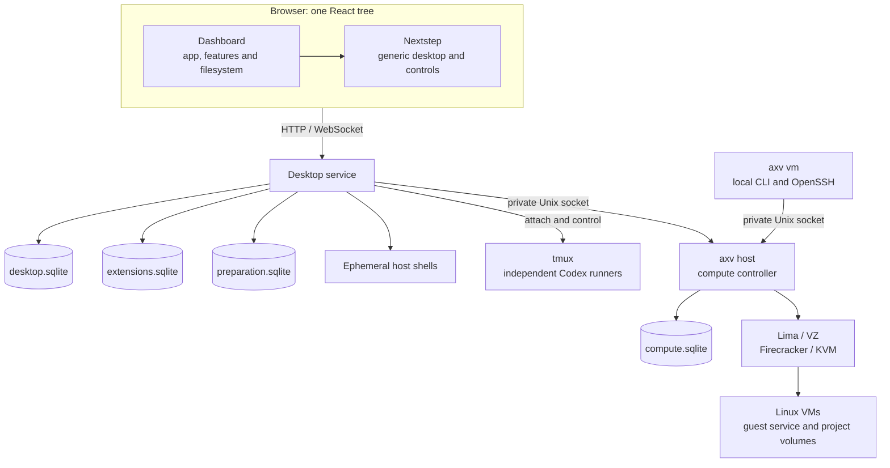

# AXV architecture

AXV combines a React browser desktop, a Go desktop service, independent Codex runners and a local VM host with Linux guest services. This overview owns dependency, identity and cross-service lifetime boundaries. Feature mechanisms and source maps belong to the references in the [task map](README.md#read-by-task); current availability belongs to [Project status](../README.md#project-status).

## Ownership and dependencies

| Boundary | Entry point and dependency rule |
| --- | --- |
| Browser composition | [`app/App.tsx`](../apps/dashboard/src/app/App.tsx) connects providers, desktop callbacks and the [feature registry](../apps/dashboard/src/app/registry.ts). Features own their definitions, views, styles and commands; they do not import this composition layer. |
| Generic desktop | [`packages/nextstep`](../packages/nextstep/src) owns windows, workspaces, Dock, Clip and menus through host callbacks and `AppDefinition` capabilities. It has no dashboard imports, hard-coded AXV app IDs or application-data access. [Desktop architecture](desktop.md) owns integration and mounted-window behavior. |
| Desktop HTTP composition | [`server.go`](../apps/server/internal/server/server.go) composes feature managers and route adapters. Adapters own transport and access checks; domain services and stores own validation and state. The [API implementation map](api/README.md#find-the-implementation) locates each boundary. |
| Documents and installed applications | [`filesystem`](../apps/dashboard/src/filesystem) owns the virtual-file model with tree logic independent of React and HTTP; [`storage`](../apps/server/internal/storage) owns desktop transactions. [Installed applications](api/extensions.md) have a separate store and sandbox broker, without host-execution or virtual-document dependencies. [Storage](storage.md) owns database and recovery mechanisms. |
| Host work | [`terminal`](../apps/server/internal/terminal) owns connection-bound shells; [`codex`](../apps/server/internal/codex) controls independent runners. Shared [`hostdir`](../apps/server/internal/hostdir) validation and [`projectfiles`](../apps/server/internal/projectfiles) access do not depend on Codex lifecycle. See [Terminal](desktop.md#terminal-sessions), [Codex](codex.md) and [project files](api/project-files.md). |
| Compute and guest | [`compute/host`](../apps/server/internal/compute/host) composes the controller, private API and provider drivers against shared `compute` contracts. Desktop gateway and CLI clients use the same verified local host boundary; [`guest`](../apps/server/internal/guest) executes inside VMs. [VM architecture](vm-platform.md) owns preparation, execution and retained projects. |
| Startup | [`cli`](../apps/server/internal/cli) owns parsing and I/O; [`app`](../apps/server/internal/app) composes desktop, host activation and preparation. [`profile`](../apps/server/internal/profile) storage and [`app/launch`](../apps/server/internal/app/launch) verification remain independent of service execution. [Startup](startup.md) owns configuration and supervision. |
| Remote access and project services | [Tailscale](api/tailscale.md) and [Cloudflare](api/cloudflare.md) add authenticated desktop listeners sharing existing feature managers. [Local previews](api/project-previews.md) and [Cloudflare publications](api/cloudflare.md#published-project-services) capture exact project targets and use separate browser origins. Shared [access rules](api/README.md#access-and-identity-boundaries) constrain every transport. |

Desktop workspaces, virtual-document IDs, host project paths, VM projects/volumes, provider conversations and process runs have separate identities. Changing a window or selection never retargets existing work. Virtual documents live in desktop SQLite; host projects remain on the host; VM project records belong to compute and their files stay on retained volumes. Links and snapshots explicitly connect these domains without changing their ownership or synchronizing files.

## Document save

Text Editor captures a snapshot and expected revision; the storage transaction either commits that snapshot or rejects it. Later typing remains dirty. Browser recovery is independent of both the server file and layout persistence. Continue with [document saves and recovery](storage.md#document-saves) and the [Files API](api/files.md).

## Codex attachment and process lifetime

Codex windows attach to an exact session/run pair recorded before launch. Explicit continuation verifies the provider conversation and creates a new run; it never retargets an old window. Terminal surfaces deliberately have different lifetimes:

| Surface | Browser disconnect or window close | Recovery boundary |
| --- | --- | --- |
| [Host Terminal](desktop.md#terminal-sessions) | Ends its shell | Opening again starts a new shell. |
| [Host Codex](codex.md) | Detaches; the managed tmux run remains alive | Reattach the recorded run, or explicitly continue verified history in a new run. |
| [Guest Terminal](vm-platform.md#guest-execution) | Detaches; the guest shell remains alive | Reattach the same terminal while its guest-service instance survives. |
| [VM project task](vm-platform.md#persistent-project-tasks) | Detaches; accepted execution and receipts persist | Inspect the original Attempt after controller restart; guest executor/VM loss interrupts it without automatic replay. |
| [Local guest SSH](api/guest.md#ssh-access) | Client disconnect closes its SSH connection | Standard SSH session lifetime, with no AXV terminal replay or recovery. |

Desktop service shutdown closes its connections and Host Terminal shells, but does not terminate independent Codex runners or VMs. Detailed cleanup and recovery belong to the linked owners.

## VM operation

The desktop gateway and VM CLI use the same private Unix socket and verify host identity on new connections. The host commits intent, capacity reservations, dependency locks and a queued operation before provider work begins outside that transaction. Clients observe the operation until a final outcome; acceptance is not completion. CLI interruption stops waiting, while accepted work remains owned by the host. See [VM state and operations](vm-platform.md#state-and-operations) for replay and uncertainty, and the [Compute API](api/compute.md) for caller obligations.

## Startup and service ownership

Desktop readiness and launch identity are independent of mutable compute configuration. Preparation can publish a verified gateway binding without replacing the desktop. VM CLI commands activate the private host without initializing a desktop or its database.

Desktop and managed VM host jobs have independent supervision. Foreground shutdown stops only the host child that invocation started; reused services retain their ownership. Controller downtime pauses queued work and task expiry. Withdrawing a remote listener closes only its clients, following the lifetime table above.

[Startup](startup.md#agent-settings-and-background-lifecycle) owns launch snapshots, identity verification and immutable executable capture; [daily commands](startup.md#daily-commands) own reuse and service operation; [configuration](startup.md#configuration-and-storage) owns precedence and paths. [`webui`](../apps/server/internal/webui) embeds production browser assets, while guest services are built into VM images separately. [Development](development.md) owns builds and verification.

## Shared infrastructure

Browser [`shared`](../apps/dashboard/src/shared) modules supply rendering, editor, API and desktop helpers. Shared Markdown rendering performs no filesystem access. The [code editor](../apps/dashboard/src/shared/code-editor) owns text presentation, position mapping and input; consuming features retain file access, target bindings, saves, recovery and external-change observation. Editor and language modules come from the embedded UI. [Deferred window loading](desktop.md#application-content-loading) remains dashboard-owned.

Backend file and locking primitives have no host-service dependencies: [`atomicfile`](../apps/server/internal/atomicfile) publishes files by atomic rename, [`filelock`](../apps/server/internal/filelock) supplies nonblocking exclusive locks and [`hostpath`](../apps/server/internal/hostpath) expands home markers and returns absolute paths. [`diagnostics`](../apps/server/internal/diagnostics) owns sanitized events independently of profiles; [`profile/logs`](../apps/server/internal/profile/logs) supplies its private rotating sink. [`artifactcache`](../apps/server/internal/artifactcache) owns public downloads independently of profile state. Feature stores own their data, identities and migration directories; the shared [`sqlitemigrate`](../apps/server/internal/sqlitemigrate) runner only validates and executes their [transactional migrations](storage.md#migration-runner).

[`httpaccess`](../apps/server/internal/httpaccess) owns shared HTTP request checks and transport-bound authenticated context. Its `LocalRequest` and `LocalPeerHost` checks retain the machine-local boundary; `AllowRequest` also accepts authority established by trusted transport middleware. [`tailnet/access`](../apps/server/internal/tailnet/access) owns Tailscale peer authorization and authenticated request lifetimes. [`cloudflare/access`](../apps/server/internal/cloudflare/access) verifies Cloudflare tokens; [`cloudflare/desktop`](../apps/server/internal/cloudflare/desktop) binds that authority to desktop requests and owns their lifetimes. Desktop composition owns route admission. Transport middleware depends on the shared checks; shared checks do not depend on providers or feature handlers. The [API access rules](api/README.md#access-and-identity-boundaries) own the transport contracts.

[`jsonfile`](../apps/server/internal/jsonfile) supplies bounded metadata reads and atomic JSON file writes across feature owners. [`jsonunicode`](../apps/server/internal/jsonunicode) checks Unicode preservation in JSON strings across HTTP, guest and agent protocols; it does not validate complete JSON syntax. They remain independent shared packages: file persistence and protocol validation have separate responsibilities. Callers own schema validation, unknown-field and trailing-data policy, and their domain's limits; neither helper supplies a universal JSON request decoder.
