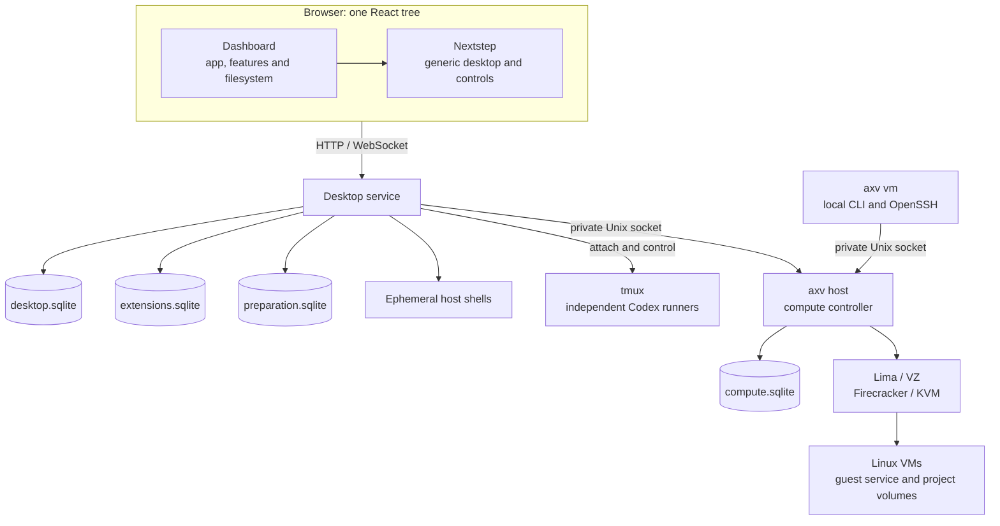

# AXV architecture

Read this overview for component boundaries, then follow the reference for the area being changed. Feature references own implementation mechanisms and source maps; the [API index](api/README.md) owns transport contracts. Current capabilities belong to [Project status](../README.md#project-status).

## Ownership and dependencies

| Boundary | Responsibility and starting point |
| --- | --- |
| Browser composition | [`app/App.tsx`](../apps/dashboard/src/app/App.tsx) connects providers, desktop callbacks and the [feature registry](../apps/dashboard/src/app/registry.ts). Features own their definitions, views, styles and commands; they do not import this composition layer. |
| Generic desktop | [`packages/nextstep`](../packages/nextstep/src) owns window, workspace, Dock, Clip and menu state. It depends on host callbacks and `AppDefinition` capabilities, never dashboard imports, hard-coded AXV app IDs or application data. See [desktop](desktop.md). |
| Virtual documents | [`filesystem`](../apps/dashboard/src/filesystem) owns the shared file model and commands; its tree algorithms are independent of React and HTTP. [`httpapi`](../apps/server/internal/httpapi) maps requests and errors to [`storage`](../apps/server/internal/storage) transactions. See [storage](storage.md). |
| Installed applications | [`extensions`](../apps/dashboard/src/features/extensions) owns application management, catalog adaptation, sandboxed frames and their typed browser broker. The independent backend [`extensions`](../apps/server/internal/extensions) owns immutable packages, installation generations, scoped sessions and private JSON documents in `extensions.sqlite`. It has no host-execution or virtual-document dependency. See the [application API](api/extensions.md). |
| Host sessions | [`terminal`](../apps/server/internal/terminal) owns connection-bound shells; [`codex`](../apps/server/internal/codex) owns Codex run operations and attachment leases, with [`codex/httpapi`](../apps/server/internal/codex/httpapi) adapting HTTP/WebSocket clients. Its private tmux backend attaches to independent [`codex/runner`](../apps/server/internal/codex/runner) processes. See [Host Terminal](desktop.md#terminal-sessions) and [Codex](codex.md). |
| Host directories | [`hostdir`](../apps/server/internal/hostdir) owns canonical directory validation, browsing and transport-independent errors, shared by Codex, Project Files and Terminal. [`hostdir/httpapi`](../apps/server/internal/hostdir/httpapi) independently registers the [directory API](api/host-directories.md); host paths remain separate from virtual-document IDs. |
| Host project files | [`projectfiles`](../apps/server/internal/projectfiles) owns registered-root file access and explicit document transfers; desktop storage owns project references, document links, snapshots, origins and transfer receipts. [`project-files`](../apps/dashboard/src/features/project-files) owns browsing; [`document-workflow`](../apps/dashboard/src/features/document-workflow) owns saved-document actions and context receipts. See the [Project Files API](api/project-files.md). |
| Compute | [`compute`](../apps/server/internal/compute) owns shared contracts and policy; [`compute/control`](../apps/server/internal/compute/control) owns durable state and the controller. [`compute/host`](../apps/server/internal/compute/host) composes the controller, private [`compute/httpapi`](../apps/server/internal/compute/httpapi) boundary and [`compute/provider`](../apps/server/internal/compute/provider) drivers; [`guest`](../apps/server/internal/guest) executes inside VMs. See [VM architecture](vm-platform.md). |
| Local VM clients | [`compute/gateway`](../apps/server/internal/compute/gateway) forwards desktop requests; [`cli`](../apps/server/internal/cli) uses [`compute/client`](../apps/server/internal/compute/client) independently of the desktop. Both verify private host connections. [`guest/sshkey`](../apps/server/internal/guest/sshkey) validates shared SSH identities; [`sshstream`](../apps/server/internal/sshstream) carries SSH through the guest service to a dedicated guest sshd. See [VM CLI](startup.md#vm-command-line) and [Guest API](api/guest.md#ssh-access). |
| VM preparation | [`compute/prepare`](../apps/server/internal/compute/prepare) owns dependency checks, verified artifacts, durable preparation tasks and configuration publication. The CLI and [`compute/prepare/httpapi`](../apps/server/internal/compute/prepare/httpapi) adapter share this engine; runtime injects service activation without making the engine depend on desktop transport. See [VM environment preparation](vm-platform.md#environment-preparation). |
| Startup | [`profile`](../apps/server/internal/profile) owns shared profile storage; [`config`](../apps/server/internal/config) resolves desktop settings. [`cli`](../apps/server/internal/cli) owns parsing and interactive I/O. [`app`](../apps/server/internal/app) composes desktop, compute activation and preparation; [`app/launch`](../apps/server/internal/app/launch) owns captured launch inputs and identity verification without depending on service execution. [`setup`](../apps/server/internal/setup) adapts preparation for the CLI, [`daemon`](../apps/server/internal/daemon) owns native supervision, and [`server`](../apps/server/internal/server) composes the listener and shutdown. See [startup](startup.md). |

Desktop workspaces, virtual-document IDs, host project paths, machines, provider conversations and process runs have separate identities. Files and Text Editor address SQLite virtual documents; selecting a host project or VM does not implicitly change their file model or execution target. Configuration and the default host workspace also remain separate from SQLite data and virtual documents.

Feature definitions keep lightweight metadata, launch identities and commands available independently of heavy window content. Dashboard-owned [deferred views](desktop.md#application-content-loading) share module loading while each mounted window retains its own state and exact target. Loading and retry do not belong to generic Nextstep or change process and recovery ownership.

Registered host projects have persistent opaque IDs and verified directory identities, independent of Codex's recent-project list. Document links organize work without changing execution; snapshot exchange copies saved content without synchronization. [Storage](storage.md#references-snapshots-and-project-exchange) owns these mechanisms; [Codex](codex.md#document-context) owns delivery to an exact run with the next user-submitted message. Shared Markdown rendering performs no filesystem access. The shared [code editor](../apps/dashboard/src/shared/code-editor) owns syntax-aware text presentation and input only; consuming features retain file permissions, target bindings, explicit saves and draft recovery. Editor and language modules load from the embedded UI rather than a third-party service.

VM projects instead belong to the compute store and identify a retained volume plus a verified root directory. Opening one captures the current VM/volume/boot/guest-service binding; file operations preserve it and execute through the guest, even when their caller is a host agent. Project Files owns visible-file observation and accepts external snapshots only when no draft, save, recovery or input is being protected; CodeMirror owns position mapping and local input, without fetching files. Replacing a VM leaves the persistent project intact and invalidates old file bindings. [VM projects](vm-platform.md#vm-projects) owns this boundary; project-file confinement does not change ordinary guest process permissions or host-agent permissions.

Project initialization composes persistent compute tasks with explicit project registration. Offline backup/restore composes provider volume copying with a separate verified project identity; neither operation moves existing conversations or tasks. The desktop-owned [`projectpreview`](../apps/server/internal/projectpreview) manager supplies independent browser origins and captures a verified compute connection for each registration. Compute and guest retain execution validation. Preview browsing is local-only; the authenticated remote desktop may inspect or stop local registrations without exposing a preview listener. [VM architecture](vm-platform.md#project-initialization) and the [preview contract](api/project-previews.md) own these mechanisms.

Host Codex can associate a conversation with one VM work project while retaining its host process and private control directory. Composition injects a verified project resolver through the compute gateway. The [`vmwork`](../apps/server/internal/vmwork) leaf depends only on compute contracts and shared file primitives; it owns the immutable run context and bundled Skill used by the runner and bound CLI. Codex storage commits the captured connection/environment with each run, and CLI tools connect to that original host rather than selecting a current profile. [Codex VM work context](codex.md#vm-project-work-context) owns launch, explicit continuation and Skill delivery.

Shared filesystem infrastructure has no host-service dependencies: [`atomicfile`](../apps/server/internal/atomicfile), [`jsonfile`](../apps/server/internal/jsonfile), [`filedigest`](../apps/server/internal/filedigest), [`filelock`](../apps/server/internal/filelock), [`hostpath`](../apps/server/internal/hostpath) and [`diskspace`](../apps/server/internal/diskspace) supply reusable primitives. [`owneddir`](../apps/server/internal/owneddir) markers express AXV ownership separately from OS ownership. [`limitedbuffer`](../apps/server/internal/limitedbuffer) bounds process output. Provider commands and configuration pins stay inside [`compute/internal/providerutil`](../apps/server/internal/compute/internal/providerutil); Lima's sparse volume-copy implementation remains private.

Feature packages own independent embedded SQL migration directories. [`sqlitemigrate`](../apps/server/internal/sqlitemigrate) supplies only catalog validation and atomic migration/initialization; desktop, installed applications, compute and preparation retain different format markers, identities and data. See [database migration rules](storage.md#migration-runner).

The browser composes installed application definitions through generic desktop capabilities; Nextstep does not parse packages or acquire application data. Untrusted content runs in an opaque-origin iframe and reaches its own data only through a typed host broker and a server-checked session. Built-in features retain their existing owners and service lifetimes. [Installed-application storage](storage.md#installed-application-storage) and the [application protocol](api/extensions.md) own the persistence and access contracts.

The shared [`artifactcache`](../apps/server/internal/artifactcache) owns user-scoped public downloads independently of profile runtime state. Release pins, image capabilities and package-source configuration belong to compute/guest owners, described in [VM architecture](vm-platform.md#image-and-capability-contract); operating configuration belongs to [startup](startup.md#shared-download-cache).

## Document save

Text Editor captures a snapshot and expected revision; the storage transaction either commits that snapshot or rejects it. Later typing remains dirty. Browser recovery is independent of both the server file and layout persistence. Continue with [document saves and recovery](storage.md#document-saves) and the [Files API](api/files.md).

## Codex attachment and process lifetime

Codex windows attach to an exact session/run pair recorded before launch. Explicit continuation verifies the provider conversation and creates a new run; it never retargets an old window. Terminal surfaces deliberately have different lifetimes:

| Surface | Browser disconnect or window close | Recovery boundary |
| --- | --- | --- |
| [Host Terminal](desktop.md#terminal-sessions) | Ends its shell | Opening again starts a new shell. |
| [Host Codex](codex.md) | Detaches; the managed tmux run remains alive | Reattach the recorded run, or explicitly continue verified history in a new run. |
| [Guest Terminal](vm-platform.md#guest-execution) | Detaches; the guest shell remains alive | Reattach the same terminal while its guest-service instance survives. |
| [VM project task](vm-platform.md#persistent-project-tasks) | Detaches; accepted execution and receipts persist | Inspect the original Attempt after controller restart; guest executor/VM loss interrupts it without automatic replay. |
| [Local guest SSH](api/guest.md#ssh-access) | Client disconnect closes its SSH connection | Standard SSH session lifetime, with no AXV terminal replay or recovery. |

Desktop service shutdown closes its connections and Host Terminal shells, but does not terminate independent Codex runners or VMs. Detailed cleanup and recovery belong to the linked owners.

## VM operation

The desktop gateway and VM CLI use the same private Unix socket and verify host identity on new connections. The host commits intent, capacity reservations, dependency locks and a queued operation before provider work begins outside that transaction. Clients observe the operation until a final outcome; acceptance is not completion. CLI interruption stops waiting, while accepted work remains owned by the host. See [VM state and operations](vm-platform.md#state-and-operations) for replay and uncertainty, and the [Compute API](api/compute.md) for caller obligations.

## Startup and service ownership

Profile storage and launch verification remain independent of application composition. Desktop configuration and compute preparation share profile storage; setup uses launch verification without importing service composition. Commands preserve the caller's context across these boundaries.

Desktop readiness and launch identity are independent of mutable compute configuration. Runtime coordination can publish a verified gateway binding after preparation without replacing the desktop. VM commands resolve compute settings and activate the private host without initializing a desktop or its database.

Desktop and managed VM host jobs have independent supervision. Foreground shutdown stops only the host child that invocation started; reused services retain their ownership. Codex runners and VMs outlive desktop shutdown, while controller downtime pauses queued work and task expiry. Local guest SSH uses the host boundary and does not change the agent's host location or introduce remote authentication.

[Startup](startup.md#agent-settings-and-background-lifecycle) owns launch snapshots, identity verification and immutable executable capture. Its [daily commands](startup.md#daily-commands) own reuse and service operations; [configuration](startup.md#configuration-and-storage) owns precedence and paths.

[`webui`](../apps/server/internal/webui) supplies embedded production UI assets. Guest services are built into VM images separately. [`localaccess`](../apps/server/internal/localaccess) owns shared host-operation access checks. Build, isolation and verification rules belong to [development](development.md).

The optional [`tailnet`](../apps/server/internal/tailnet) transport owns one persistent userspace Tailscale node per profile, enrollment, HTTPS certificates and its listener. It starts independently of local desktop readiness and does not control the system Tailscale daemon or host DNS. [`remoteaccess`](../apps/server/internal/remoteaccess) authenticates the connection's actual peer through that node's `WhoIs`, authorizes the bound owner and supplies request-scoped authentication to feature guards. Both transports share desktop storage and feature managers, preserving terminal limits and exact Codex/VM identities. Withdrawing the remote transport cancels only its HTTP/WebSocket clients; host shells end, Codex attachments detach and accepted VM work retains its existing lifetime. [Tailscale remote access](api/tailscale.md) owns the authorization contract; [startup](startup.md#remote-access) owns enrollment and shutdown.

The desktop service's [remote controller](../apps/server/internal/server/remote_controller.go) owns a serialized enable/disable lifecycle and persists the preference through shared profile storage. Remote settings stay outside captured launch inputs and fingerprints. The feature-owned Tailscale panel controls only that embedded transport through the local API; it does not detect or manage a system VPN. [Application registration](desktop.md#register-an-application) owns the utility's integration with generic launch controls.

[`diagnostics`](../apps/server/internal/diagnostics) owns structured events, sanitization and write-failure status without depending on profiles or composition. [`profile/logs`](../apps/server/internal/profile/logs) depends on it and owns the private rotating sink and supervisor log access. Composition supplies loggers and paths; hosts keep their supervision-owned stderr. Logs exclude session streams, credentials and document contents, and log failures cannot change committed outcomes. [Startup](startup.md) owns log locations and commands.
