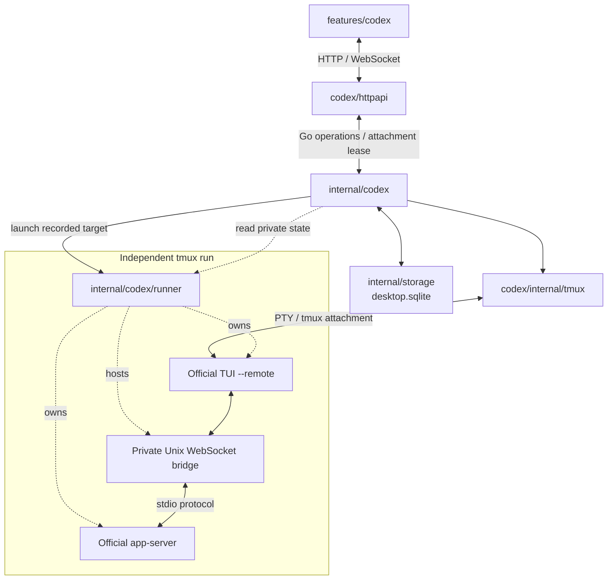

# Host Codex architecture

This reference owns provider identity, runtime initialization, continuation and process ownership. See the [API](api/host-codex.md) for caller contracts and limits, [usage](usage.md#codex) for actions, and [startup](startup.md#agent-settings-and-background-lifecycle) for configuration. The overview compares [terminal lifetimes](architecture.md#codex-attachment-and-process-lifetime).

## Implementation map

| Change | Start here |
| --- | --- |
| Windows and user actions | [`definition.ts`](../apps/dashboard/src/features/codex/definition.ts), [`CodexManager.tsx`](../apps/dashboard/src/features/codex/CodexManager.tsx), [`continuation.tsx`](../apps/dashboard/src/features/codex/continuation.tsx) |
| HTTP and terminal transport | [`httpapi`](../apps/server/internal/codex/httpapi) owns routes, request decoding and WebSocket frames; frontend [`session.ts`](../apps/dashboard/src/features/codex/session.ts) owns the terminal controller |
| Service queries, metadata and attachments | [`service.go`](../apps/server/internal/codex/service.go), [`attachment.go`](../apps/server/internal/codex/attachment.go) and [`input.go`](../apps/server/internal/codex/input.go) |
| Document snapshots and delivery receipts | Service [`context.go`](../apps/server/internal/codex/context.go), runner [`context.go`](../apps/server/internal/codex/runner/context.go) and [`bridge.go`](../apps/server/internal/codex/runner/bridge.go) |
| Reservation, launch and End | [`lifecycle.go`](../apps/server/internal/codex/lifecycle.go), [`launch.go`](../apps/server/internal/codex/launch.go), storage [`codex_runs.go`](../apps/server/internal/storage/codex_runs.go) |
| Reconciliation and history checks | [`runtime.go`](../apps/server/internal/codex/runtime.go), [`history.go`](../apps/server/internal/codex/history.go), [`coordination.go`](../apps/server/internal/codex/coordination.go) |
| Provider bridge and child processes | [`codex/runner`](../apps/server/internal/codex/runner): `bridge.go`, `protocol.go` and `run_unix.go` |
| tmux backend and PTY clients | [`internal/tmux`](../apps/server/internal/codex/internal/tmux) owns explicit runtime targets, launch setup, attachment processes, scrollback and size barriers |
| Names, archives and recent projects | Service [`service.go`](../apps/server/internal/codex/service.go); storage [`codex_metadata.go`](../apps/server/internal/storage/codex_metadata.go) and [`codex_projects.go`](../apps/server/internal/storage/codex_projects.go) |
| Host project directory selection | Shared [`hostdir`](../apps/server/internal/hostdir), registered by [`server`](../apps/server/internal/server/server.go) |

Start regression work with [`codex_runs_test.go`](../apps/server/internal/storage/codex_runs_test.go), the runner's [`bridge_test.go`](../apps/server/internal/codex/runner/bridge_test.go), and service tests beside the affected module. [`codex-history.spec.ts`](../tests/codex-history.spec.ts) covers user-visible run isolation. [Development](development.md#verification) owns commands and isolated tmux/CLI test setup.

## Ownership and identity

The `codex` package owns ordinary Go operations for creating, continuing, querying and ending exact runs, updating metadata and leasing attachments. These operations expose contexts and feature values without HTTP or WebSocket parameters. Its [`httpapi`](../apps/server/internal/codex/httpapi) adapter owns access checks, strict JSON decoding, error-to-status mapping and the WebSocket protocol. Service errors describe invalid input, conflicts or unavailability independently of HTTP status codes.

The private [`tmux`](../apps/server/internal/codex/internal/tmux) backend accepts explicit socket/session targets and launch inputs. It owns native commands, setup/environment isolation, PTY clients, scrolling and size barriers without importing storage, configuration or the service. The service maps recorded runs to these targets, persists the confirmed socket before setup continues, and retains lifecycle and input gates.

The [`runner`](../apps/server/internal/codex/runner) subpackage owns the independent process and official provider protocol; it does not import the manager, desktop configuration or storage. The CLI invokes the runner directly, so this subpackage is available to server-internal consumers rather than hidden behind a second `internal` directory.

The desktop composition root supplies resolved [`Options`](../apps/server/internal/codex/options.go) instead of passing the desktop configuration into the feature. Shared host directory validation and browsing belong to [`hostdir`](../apps/server/internal/hostdir), whose route is registered independently by the desktop server. Other host features can validate projects without depending on Codex or its lifecycle.

Codex's provider UUID, history home, app-server bridge and readiness proof remain provider-specific. There is no shared agent protocol or provider registry. Storage records and capacity policy address host Codex, rather than defining contracts for another provider. The desktop storage owner retains the conversation/run transactions in the same database as its existing schema and identity.

- **Conversation:** a stable AXV session binds one provider UUID and project. Workspaces, paths and virtual-document IDs remain separate identities.
- **Run:** each process attempt records its own ID, tmux target and socket. Attach, End, input, resize and scroll address that exact session/run pair; old windows never resolve commands to the latest run.
- **Ownership:** the runner survives browsers and service cancellation. It reaps only its own children when its TUI or tmux runtime ends. Service shutdown closes attachment clients, leaving the runner alive.

## Desktop feature

The definition stays registered when dependencies fail; availability controls launcher visibility. A run window's identity requires both session and run IDs; otherwise the definition opens the manager. Layout excludes project paths, process state and transcripts. The singleton non-modal Environment panel shares the manager's availability provider; detailed presentation belongs to [design](design.md#application-design-boundaries).

## Runner and provider protocol

New-conversation creation separates an attachable runtime from provider readiness:

1. The service validates the canonical project and request identity, then commits a conversation, starting run and capacity reservation before launching its recorded tmux target. Matching retries recover that reservation.
2. The independent runner starts the official app-server and TUI, connected through a private Unix WebSocket bridge. A starting run already accepts terminal attachments for trust and sign-in interactions.
3. The bridge captures the provider UUID from `thread/start` and uses `thread/name/set` to persist the empty thread before acknowledging initialization. No first model turn is required.
4. The runner publishes private ready state. When reconciliation observes that durable proof, it binds the provider identity and records the confirmed start before inspecting tmux's current outcome. A failed runner record can preserve identity without confirming a start. Runtime readiness does not establish model connectivity.

Identity comes only from structured responses. Resume uses the stored UUID; terminal output and history-file scans never select a conversation. After binding, the managed TUI cannot create, fork or switch conversations.

The bridge forwards protocol content without storing transcripts. Private state holds run ID, provider ID, history home, startup outcome and document-context capability version; manifests/state contain no transcripts or credentials. The separate document queue below temporarily retains explicitly selected snapshot content. Codex owns authentication, approvals, sandbox and model configuration. Changes to this provider integration require checking current provider documentation as well as the local bridge tests.

The desktop supplies its fixed executable for each AXV runner. Run manifests, state and a separate private `exit.json` live under the desktop data directory; the runner's private bridge socket lives in an owned short directory beneath `AXV_HOME/run/codex`. The runner publishes its exact run ID and wrapper exit code only after stopping and reaping its children, cleaning up its socket and releasing conversation ownership. This exit record preserves the independent readiness and provider-identity state. Socket paths are checked before launch and never silently moved to another profile or the system temporary directory. Ending a run removes only its own socket directory. Provider history and credentials remain in the official CLI's history home.

A private AXV-owned conversation lock stays held until the runner has stopped and reaped its TUI and app-server. End waits for that ownership to be released before reporting completion, and explicit continuation waits before verifying history or reserving a new run. This prevents a disappearing tmux session from allowing another provider writer to overlap cleanup. An unconfirmed End remains stopping with a visible error; coordination never reads or changes provider-owned lock files. See [runner ownership](../apps/server/internal/codex/runner/ownership_unix.go) and [lifecycle](../apps/server/internal/codex/lifecycle.go).

## Document context

Documents remain virtual SQLite entries. Explicit delivery resolves immutable snapshot IDs through the storage owner, verifies the source database and content digest, and records the destination's session ID, run ID and verified provider thread ID. The client cannot supply attachment text or choose a provider thread. Later edits, source deletion and a newer run do not change a queued snapshot or redirect its destination. Snapshot persistence belongs to [document storage](storage.md); delivery requests and limits belong to the [context API](api/host-codex.md#document-context).

### Durable queue

The service and independent runner share a private `context.json` and `context.lock` in the recorded run directory. The runner initializes its empty queue before publishing readiness and the context capability; subsequent failures preserve that capability as evidence that receipts must exist. Ordinary reads, writes and dispatch never recreate a missing queue. A cross-process lock serializes queue changes, cancellation, dispatch and acknowledgments. Atomic publication flushes the file and its containing directory; missing established state, malformed, non-private or mismatched state is rejected without resetting it. Semantic validation checks receipt identity, uniqueness and delivery state, and verifies pending content against its snapshot metadata and digest before consumption. The lock wait is bounded and cancellable. This control queue has no storage dependency inside the runner and survives desktop-service shutdown with its original run.

### Provider dispatch

Only the official TUI submits user messages. When it sends its next nonempty user-input `turn/start` or `turn/steer` for the exact thread, the bridge appends each pending snapshot as an ordinary text input using the [official turn input contract](https://learn.chatgpt.com/docs/app-server#turns). The original input items and all other fields, including turn-start model, approval, sandbox and collaboration settings, are preserved. Explicit steering also preserves the TUI's required `expectedTurnId`; the provider verifies that active-turn precondition. Queuing in AXV does not type into the terminal, submit a message, independently start or steer a turn, or create a conversation. A message buffered in the TUI consumes attachments only when the TUI actually submits it. Tool-only turns and malformed steering requests do not consume attachments. If the combined protocol message exceeds the bridge limit, the snapshots fail visibly and the original user message is forwarded unchanged.

Dispatch first durably changes pending receipts to `unknown`, then writes the augmented request to the provider. Only a matching structured response containing a valid provider turn ID makes a receipt `accepted`: `turn/start` returns `turn.id`, while `turn/steer` must return `turnId` equal to its requested `expectedTurnId`. An explicit provider error, including a stale steering precondition, makes the receipt `failed` without requeuing it. Provider approval requests reusing the numeric request ID cannot acknowledge delivery. A disconnect, process crash, missing turn ID or mismatched steering turn ID leaves `unknown`, even when the provider may already have received the message. Such receipts are never automatically replayed. Pending content is removed from the queue at dispatch or cancellation; immutable source content remains in SQLite and the provider owns its accepted conversation history.

### Ending and cancellation

Cancellation wins only while a batch is pending under the same queue lock. Once dispatch claims it, cancellation reports a state conflict. End closes the queue after committing its stopping intent and before terminating the exact runtime: pending batches fail, while attempted deliveries retain their acknowledgment or uncertainty. A rejected End that cannot commit its intent leaves pending delivery intact; an already final run still closes its initialized queue. Runner exit also closes its pending queue. If acknowledgment and End race, a matching provider response can still confirm an attempted batch; neither operation transfers it to a newer run. Queue damage cannot prevent the exact runtime from being ended, and the queue error remains visible. A new run created by explicit continuation begins with no pending document delivery. Older live runners lacking the context capability reject new attachments and require explicit End and continuation to use the updated runner.

## tmux routing and environment

- New runs use the default server unless `AXV_TMUX_SOCKET` selects another. Names combine database/data-directory identity with run ID. Recorded routing survives configuration changes.
- AXV changes only owned sessions/windows: no global options/environment, unrelated-session termination or application `kill-server`. Current environment arrives through tmux stdin, not secret-bearing arguments or stale server values.
- [Startup](startup.md#host-agent-defaults) owns proxy/settings precedence; [development](development.md) owns isolated sockets, homes and cleanup.

## Continuation and reconciliation

- Only confirmed continuation verifies the original canonical project and exact provider thread through a read-only lookup in the stored history home, then reserves a new run for that UUID. Verification and launch explicitly use that stored home even if the service's current `CODEX_HOME` differs. Unavailable or unverifiable history, changed project identity or uncertain runtime blocks continuation without a replacement conversation.
- Resume retains names/archive state and saved conversation context, not PTYs, scrollback or interrupted commands. `expectedRunId` must match the predecessor; unknown outcomes retain their request identity. Cancelling the confirmation creates nothing.
- List/detail reads never launch a provider process; reload, reconnect and service restart never continue history. Open Running Session opens a separate view; the old window stays bound to its original run.
- Reconciliation reads fresh durable state under the run gate. Startup grace protects reservations during bounded launch; inspection failure is availability uncertainty, not an ended/lost verdict. Final runs never resurrect; interrupted ending remains retryable.
- A closed tmux pane can precede its published exit outcome. Reconciliation briefly retries the exact pane. If its exit status and signal remain entirely absent, a validated private exit record for that exact run can establish the outcome after conversation ownership is confirmed released. This also handles older tmux builds that lose the child-exit notification while updating utmp. An exit record never ends a live pane or overrides a malformed or contradictory tmux outcome. Without a verified outcome, or while runner cleanup remains pending, the run stays visible with availability uncertainty. Cleanup must remove the exact owned session before final status is persisted; failures remain retryable through End Session.

## Storage and concurrency

- **Reservation:** commit before process creation, enforcing one active run per conversation and service capacity, including archived/transitional runs. Matching request retries recover the reserved run before rechecking conditions that may have changed; original payload/dimensions stay bound.
- **Relationships:** conversations and runs are separate records. Predecessors derive run mode; foreign keys protect predecessor/latest-run links. Initialized provider IDs are unique within their history home.
- **Metadata:** titles, archives and revisions change independently of runtime, without tmux reconciliation. Mounted views merge revisions and refresh details without reconnecting. Recent projects update transactionally only on a run's first confirmed starting-to-running transition. Reads, attachments or retries can discover that transition; they do not reorder an already-confirmed run.
- **Concurrency:** reconciliation/End share a per-run gate; input has a separate gate. Gates accept cancellation and disappear when unused. The manager mutex covers operation admission, attachment capacity and leases, not slow host commands. The HTTP adapter separately admits and drains requests, including incomplete bodies and hijacked terminal connections. Service cancellation stops ordinary operations and detaches leases; the server also closes the adapter to finish transport cleanup. Neither layer kills independent runs during shutdown.

## Terminal attachments

The frontend owns xterm, bounded queues, sizing, scrolling and reconnect backoff. An explicit `attach_failed` control uses the same bounded backoff as a transient disconnect, revalidating the original session/run pair before each attachment. Persistent failures remain visible with an explicit Reconnect action; access rejection, a different run or a final run stops recovery. Closing the window, losing its connection or stopping the desktop service disposes attachment clients without ending the managed run. End Session terminates only the exact recorded run. Reconnect targets that original run and discards unsent input.

`PrepareAttachment` validates the exact run and reserves capacity before transport upgrade. `Open` restores live input and starts the PTY client after upgrade. Parent cancellation and `Detach` interrupt native I/O; `Close` releases the reservation only after the transport drains its forwarding workers. Ordinary Go callers also close their leases explicitly. Attachment inspection reports runtime uncertainty directly, while list/detail views preserve known identities with a transient reason.

PTY startup failures retain the failing stage (start, descriptor duplication or nonblocking setup) and native cause in the private diagnostic logger, with the exact run ID and executable. Browser messages remain safe and do not include native diagnostics. Logs use the shared sanitizer and contain no terminal streams, provider configuration or environment snapshots; see [service diagnostics](startup.md#configuration-and-storage).

`--no-alt-screen` retains tmux history; reattachment/fresh input leave copy mode. History scrolling sends scroll commands, never composer keystrokes. Hidden input, focus and owner-bound commands follow [desktop contracts](desktop.md).

Clipboard actions follow the shared [clipboard input](desktop.md#clipboard-input) boundary. Reconnection invalidates pending clipboard reads and paste dialogs, even when attaching again to the same run.

See the [attachment protocol](api/host-codex.md#attachment-protocol-and-ending) for transport details and the shared [Host directory API](api/host-directories.md) for local directory selection.
