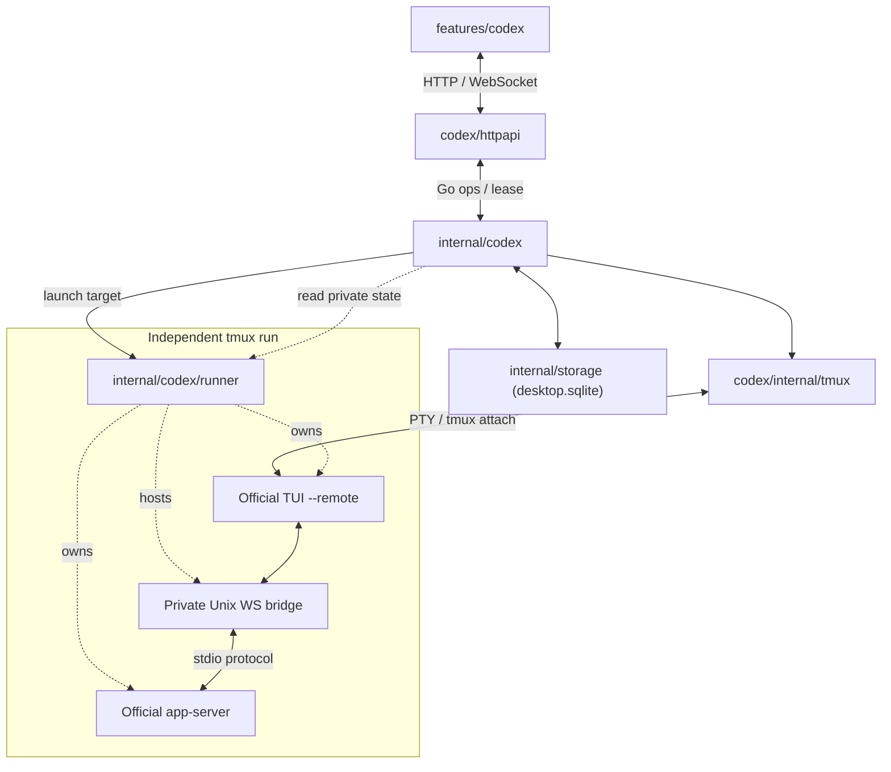

# Host Codex architecture

This reference owns Codex provider integration, process/run ownership, reconciliation, activity journals and terminal attachments. See [Host Codex API](api/host-codex.md) for routes/limits, [usage](usage.md#codex) for user actions, [startup](startup.md#host-agent-defaults) for proxy/tmux defaults, and [architecture](architecture.md#codex-attachment-and-process-lifetime) for surface lifetimes.

## Implementation map

| Change | Start here |
| --- | --- |
| Dashboard manager, continuation & terminal | [`definition.ts`](../apps/dashboard/src/features/codex/definition.ts), [`CodexManager.tsx`](../apps/dashboard/src/features/codex/CodexManager.tsx), [`VMNewSessionPanel.tsx`](../apps/dashboard/src/features/codex/VMNewSessionPanel.tsx), [`vm-api.ts`](../apps/dashboard/src/features/codex/vm-api.ts), [`continuation.tsx`](../apps/dashboard/src/features/codex/continuation.tsx), [`session.ts`](../apps/dashboard/src/features/codex/session.ts) |
| HTTP & WebSocket adapter | [`codex/httpapi`](../apps/server/internal/codex/httpapi) |
| Zero-credential host VM LLM proxy | [`codex/vmproxy`](../apps/server/internal/codex/vmproxy), [`vmproxy_linux.go`](../apps/server/internal/compute/provider/firecracker/vmproxy_linux.go) |
| Guest-embedded Codex service | [`guest/codex.go`](../apps/server/internal/guest/codex.go), [`guest/codex_proxy_linux.go`](../apps/server/internal/guest/codex_proxy_linux.go) |
| Service queries, lifecycle & attachments | [`service.go`](../apps/server/internal/codex/service.go), [`lifecycle.go`](../apps/server/internal/codex/lifecycle.go), [`launch.go`](../apps/server/internal/codex/launch.go), [`attachment.go`](../apps/server/internal/codex/attachment.go), [`input.go`](../apps/server/internal/codex/input.go) |
| Reconciliation, history & coordination | [`runtime.go`](../apps/server/internal/codex/runtime.go), [`history.go`](../apps/server/internal/codex/history.go), [`coordination.go`](../apps/server/internal/codex/coordination.go) |
| Independent runner, bridge & activity | [`codex/runner`](../apps/server/internal/codex/runner): `bridge.go`, `protocol.go`, `run_unix.go`, `ownership_unix.go`, `activity.go`, `activity_events_unix.go` |
| Notification source | [`notification_events.go`](../apps/server/internal/codex/notification_events.go) |
| Private tmux backend | [`codex/internal/tmux`](../apps/server/internal/codex/internal/tmux) |
| Persistence | [`codex_runs.go`](../apps/server/internal/storage/codex_runs.go), [`codex_metadata.go`](../apps/server/internal/storage/codex_metadata.go), [`codex_projects.go`](../apps/server/internal/storage/codex_projects.go) |

Start regression work with [`codex_runs_test.go`](../apps/server/internal/storage/codex_runs_test.go), [`bridge_test.go`](../apps/server/internal/codex/runner/bridge_test.go), service tests beside the changed file, and [`codex-history.spec.ts`](../tests/codex-history.spec.ts).

## Ownership and identity

- **Package boundaries:** `internal/codex` owns transport-agnostic Go operations and receives resolved [`Options`](../apps/server/internal/codex/options.go) from composition. `codex/httpapi` owns access checks, strict JSON decoding and WS framing. `codex/internal/tmux` accepts explicit targets without importing storage/config. `codex/runner` owns the independent process and official provider protocol without importing manager/storage (invoked directly by the CLI). Shared host directory browsing stays in [`hostdir`](../apps/server/internal/hostdir).
- **Separate identities:** A **Conversation** binds one provider UUID and host directory; each **Run** records its own ID, tmux target and socket. Attach, End, input, resize and scroll address that exact `(sessionId, runId)` pair — old windows never retarget to newer runs.
- **Process lifetime:** Runners survive browser disconnects and desktop shutdown and reap only their own children. There is no generic multi-provider abstraction; Codex identity and protocol stay provider-specific.

## Runner, provider protocol, and activity

1. **Reserve before launch:** Service validates canonical project + `requestId`, commits conversation/starting run/capacity reservation, then launches the recorded tmux target (matching retries recover that reservation).
2. **Bridge & readiness:** Runner starts official `app-server` and `TUI --remote` over a private Unix WebSocket bridge under `AXV_HOME/run/codex` (short path verified before launch, never relocated to `/tmp`). Starting runs accept attachments immediately for trust/sign-in.
3. **Structured identity only:** Bridge captures provider UUID from `thread/start`, persists the empty thread via `thread/name/set`, and publishes private ready state. Reconciliation binds provider identity from durable proof only — never from terminal scraping or history scans. Managed TUI cannot create, fork or switch threads.
4. **Private ownership lock & exit proof:** An AXV-owned conversation lock stays held until the runner stops/reaps TUI + `app-server`, cleans its socket and publishes private `exit.json`. End and explicit continuation wait for lock release before completing or reserving a new run.

### Provider activity

- [`runner/activity.go`](../apps/server/internal/codex/runner/activity.go) observes official `app-server` events for the bound thread/turn (turn lifecycle, thread flags, pending approvals/input and MCP elicitations) without answering approvals or changing forwarding.
- Runner atomically publishes content-free `activity.json` (no prompts, commands, approval bodies or transcripts) and appends to [`activity-events.json`](../apps/server/internal/codex/runner/activity_events_unix.go) (bounded to **512 events / 512 KiB per run**) so notifications survive desktop downtime. Publication failures write unavailable markers and expose explicit gaps rather than silently resetting journals.
- [`notification_events.go`](../apps/server/internal/codex/notification_events.go) scans all recorded runs (including archived/superseded) with exact `(databaseId, sessionId, runId, threadId, turnId, eventId)` identities; nonterminal tails require live-run confirmation.
- Failed/interrupted alert dismissals persist per `(runId, eventId)` in private `activity-review.json` under the run gate; normal completion requires no dismissal.

## tmux routing, continuation, and concurrency

### tmux routing and environment

- Uses the default tmux server unless `AXV_TMUX_SOCKET` selects another; session names combine database/data-dir identity with run ID, and recorded routing survives later config changes.
- Only owned sessions/windows are modified: never touch global tmux options/env, unrelated sessions or `kill-server`. Runtime env arrives via stdin, never secret-bearing CLI arguments.

### Continuation, reconciliation, and concurrency

- **Continuation:** Only explicit user confirmation verifies original project + exact provider thread in the stored `historyHome` (ignoring a changed service `CODEX_HOME`) and reserves a new run with `expectedRunId`. Reads, reload, reconnect and restart never auto-continue. [`CodexResumeRequests`](../apps/dashboard/src/features/codex/continuation.tsx) isolates per-session in-flight requests from recoverable receipts.
- **Reconciliation:** Reads fresh durable state under the per-run gate. Inspection failure reports uncertainty, never `ended`/`lost`. For closed panes lacking tmux exit status (e.g. older tmux utmp races), a validated `exit.json` after lock release establishes final status. Cleanup must remove the owned tmux session before persisting final status.
- **Concurrency:** Per-run gate serializes reconciliation/End; input uses a separate gate. Manager mutex covers admission/leases only (never slow host commands). Metadata edits (`title`/`archived`) never probe tmux; recent host projects update transactionally only on a run's first confirmed `starting → running` transition.

## Terminal attachments

- Frontend owns xterm, queues, coalesced resizing, scroll controls and bounded reconnect backoff (revalidating `(sessionId, runId)` on transient disconnects and `attach_failed`; stopping on final state or access denial).
- `PrepareAttachment` validates and reserves capacity before upgrade; `Open` starts the PTY client after upgrade and waits for tmux client registration before sending `ready` (ordering initial resize behind client setup). `Close` releases capacity only after forwarding workers drain.
- Uses `--no-alt-screen` for tmux history; fresh input/reattach exits copy mode; scrolling sends scroll commands rather than composer keys. Clipboard follows [shared clipboard input](desktop.md#clipboard-input). PTY startup failures log stage/cause to sanitized private diagnostics without exposing native errors to browsers.
